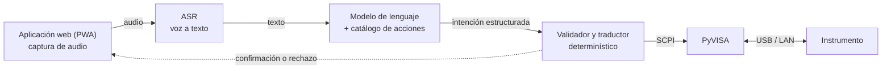

# Control de instrumentación electrónica por lenguaje natural

Sistema que permite operar instrumental electrónico de laboratorio —osciloscopios, generadores de
funciones, fuentes programables— **hablándole**, en lugar de navegar sus menús o escribir comandos.
El usuario dice *"poné el canal uno en quinientos milivoltios por división"* y el sistema traduce
ese pedido a la instrucción **SCPI** (*Standard Commands for Programmable Instruments*) que el
instrumento entiende, la valida y la ejecuta.

Proyecto del laboratorio **InDEA** (Investigación y Desarrollo en Electrónica Aplicada), UTN
Facultad Regional Mendoza.

- **Responsable:** Juan Pablo Masuet — Práctica Profesional Supervisada (PPS)
- **Director:** Javier Velez
- **Estado:** Fase 0 — relevamiento y definiciones. No hay implementación todavía.
- **Licencia:** [MIT](LICENSE)

## Motivación

Operar un instrumento de laboratorio exige conocer su interfaz: la jerarquía de menús de ese
modelo, o la sintaxis de su conjunto de comandos remotos. Las dos cosas son específicas del
fabricante y se olvidan entre una práctica y la siguiente. En un laboratorio de docencia e
investigación esto tiene un costo concreto: tiempo perdido en el manual, configuraciones mal
puestas y mediciones que hay que repetir.

La hipótesis del proyecto es que un **modelo de lenguaje** puede absorber esa especificidad. El
usuario expresa la intención en su propio vocabulario y el sistema se encarga de la traducción, la
validación y el diálogo de confirmación. La misma frase debería servir para instrumentos de
fabricantes distintos.

## Arquitectura

El sistema se organiza como una **cascada** de cuatro etapas, con una frontera explícita entre lo
probabilístico y lo determinístico:



**La decisión de diseño central del proyecto es que el modelo de lenguaje no emite SCPI.** Emite
una **intención estructurada** —una acción de un catálogo cerrado, con sus parámetros— y una capa
determinística posterior es la que arma el comando, verifica que los valores estén dentro del rango
admisible del instrumento y recién entonces lo envía. Esa frontera es lo que hace auditable al
sistema: todo lo que llega al instrumento pasó por código verificable, no por la salida libre de un
modelo. El detalle está en [`docs/arquitectura.md`](docs/arquitectura.md) y el esquema de la
intención en [`docs/esquema_intencion.md`](docs/esquema_intencion.md).

## Alcance por etapas

El proyecto avanza en etapas deliberadamente cortas, cada una con un entregable que funciona:

| Etapa | Qué se construye | Estado |
|---|---|---|
| **1 — Prototipo** | Cadena completa extremo a extremo con un modelo comercial de pago y un catálogo de **entre cinco y diez acciones** sobre un solo instrumento. Sirve para validar la idea, no para producción. | Por empezar |
| **2 — Ampliación** | Catálogo extendido, esquema de intención formalizado, cobertura de más instrumentos y del vocabulario real de los usuarios. | Pendiente |
| **3 — Modelo propio** | Construcción del conjunto de datos y **ajuste fino** de un modelo abierto y chico (Qwen3-4B, Gemma 3 4B o equivalente, a definir) que corra en el laboratorio sin depender de un servicio pago. | Pendiente |
| **4 — Evaluación** | Comparación de la cascada contra un **modelo multimodal con entrada de voz**, que se saltea la etapa de transcripción. Métricas, informe final. | Pendiente |

El plan completo, con objetivos específicos y criterios de aceptación de cada fase, está en
[`00_PLAN.md`](00_PLAN.md).

## Organización del repositorio

| Ruta | Contenido |
|---|---|
| [`00_PLAN.md`](00_PLAN.md) | Objetivo general, objetivos específicos, fases y criterios de aceptación. |
| [`BITACORA.md`](BITACORA.md) | Registro cronológico del trabajo. **Es el registro formal de la PPS.** |
| [`docs/arquitectura.md`](docs/arquitectura.md) | Las etapas de la cascada, las alternativas evaluadas y las decisiones abiertas. |
| [`docs/esquema_intencion.md`](docs/esquema_intencion.md) | El contrato entre el modelo de lenguaje y el resto del sistema. |
| [`docs/scpi.md`](docs/scpi.md) | Qué es SCPI, cómo se descubre el conjunto de comandos de un instrumento y el catálogo de la etapa 1. |
| [`docs/estado_del_arte.md`](docs/estado_del_arte.md) | Relevamiento de antecedentes: trabajos previos, modelos de ASR y bibliotecas de instrumentación. |
| [`docs/dataset.md`](docs/dataset.md) | Plan de construcción del conjunto de datos y de ajuste fino (etapa 3). |
| [`docs/evaluacion.md`](docs/evaluacion.md) | Métricas y protocolo experimental. |
| [`app/`](app/) | Aplicación web (PWA) de captura de audio. |
| [`servidor/`](servidor/) | Servicio que transcribe, interpreta, valida y envía los comandos. |
| [`instrumentos/`](instrumentos/) | Una ficha por instrumento: interfaz física, comandos disponibles y límites. |
| [`modelos/`](modelos/) | Binarios de modelos con los que se experimenta (ASR, y luego modelos de lenguaje locales); no versionados, con su registro de pruebas. |

## Cómo se trabaja acá

`main` está protegido: los cambios entran por **pull request** con revisión del director.

```bash
git switch -c descripcion-corta-del-cambio
# ... trabajar, git add, git commit ...
git push -u origin descripcion-corta-del-cambio
gh pr create      # o desde la web de GitHub
```

Convenciones:

- La documentación se escribe **en español**, expandiendo las siglas la primera vez que aparecen.
- **Cada avance queda documentado**: la entrada en [`BITACORA.md`](BITACORA.md) y el documento de
  `docs/` que corresponda van en el mismo pull request que el código.
- **Ningún dato personal ni credencial entra al repositorio**, que es público. Las claves de las
  interfaces de programación de aplicaciones (API) de los servicios pagos van en variables de
  entorno, nunca en el código ni en un archivo versionado.
