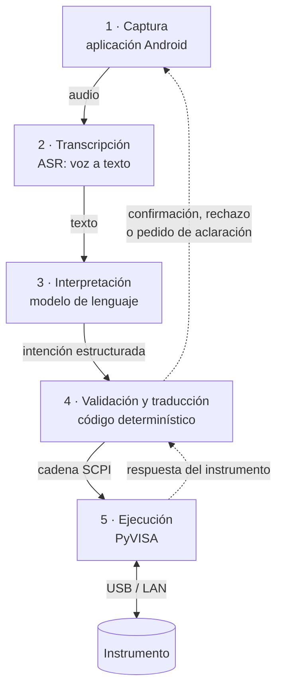

# Arquitectura

> **Estado: propuesta inicial.** Las decisiones marcadas como *abiertas* son parte del trabajo de
> la fase 0, no omisiones. Cuando una se cierra, se escribe acá con su fundamento y se registra en
> la tabla de decisiones cerradas de [`../00_PLAN.md`](../00_PLAN.md).

## 1. Visión general

El sistema toma una instrucción hablada y termina configurando un instrumento. Entre esos dos
extremos hay cinco etapas:

| Etapa | Naturaleza | Responsabilidad |
|---|---|---|
| 1 · Captura | Determinística | Grabar el audio y entregarlo al servidor. |
| 2 · Transcripción | **Probabilística** | Convertir el audio a texto. |
| 3 · Interpretación | **Probabilística** | Convertir el texto a una acción del catálogo, con sus parámetros. |
| 4 · Validación y traducción | Determinística | Verificar que la acción exista, que los parámetros estén en rango, y armar el comando. |
| 5 · Ejecución | Determinística | Enviar el comando y leer la respuesta. |

## 2. El principio de diseño: dónde está la frontera

Las etapas 2 y 3 son probabilísticas: pueden equivocarse, y se van a equivocar. Las etapas 4 y 5
son determinísticas: hacen siempre lo mismo y se pueden probar con tests.

**La frontera entre unas y otras es lo que define la seguridad del sistema**, y por eso está puesta
donde está: el modelo de lenguaje **no produce comandos SCPI**. Produce una **intención
estructurada** —el nombre de una acción de un catálogo cerrado, más sus parámetros— y a partir de
ahí todo es código auditable.

Las consecuencias son concretas:

- Una acción que no existe en el catálogo **no se puede expresar**. No hay forma de que el modelo
  invente un comando.
- Un parámetro fuera de rango se rechaza **antes** de tocar el instrumento, con un mensaje al
  usuario, y no como un error del instrumento después del hecho.
- El comportamiento del sistema frente a una intención dada se puede probar sin el modelo y sin el
  instrumento, con tests comunes.
- Cambiar de modelo de lenguaje —o cambiar el modelo comercial por el propio en la etapa 3— **no
  toca la capa de ejecución**. El esquema de intención es el contrato que los desacopla.

La alternativa —pedirle al modelo que devuelva la cadena SCPI directamente— es más corta de
escribir y es la que se descarta: hace que cada alucinación del modelo sea un comando que llega al
instrumento, y vuelve imposible razonar sobre qué puede y qué no puede pasar.

## 3. Las etapas, una por una

### 3.1 Captura — aplicación Android

Graba el audio mientras el usuario mantiene presionado un botón y lo envía al servidor. Muestra la
transcripción, la acción interpretada y el resultado.

**Abierto (D4):** el transporte. Las opciones razonables son subir el archivo de audio completo por
HTTP al terminar de hablar —simple, con latencia igual a la duración del enunciado— o transmitirlo
por WebSocket a medida que se graba —más complejo, con transcripción parcial en vivo—. Para la
etapa 1 la simplicidad gana salvo que la latencia resulte intolerable en la práctica.

Detalle en [`../app/README.md`](../app/README.md).

### 3.2 Transcripción — reconocimiento automático del habla (ASR)

Convierte el audio en texto. El vocabulario del dominio es técnico y castellanizado a medias
—"volt por división", "trigger", "duty cycle", "punta x10"— y ese es justamente el caso donde un
motor genérico falla más.

**Abierto (D2):** motor local (por ejemplo Whisper en alguna de sus variantes, corriendo en una
placa del laboratorio) contra servicio en la nube. Los criterios de decisión son la tasa de error
de palabra sobre **nuestro** vocabulario, la latencia, el costo y si el sistema tiene que funcionar
sin conexión. Medirlo antes de elegir, con el corpus de prueba de
[`evaluacion.md`](evaluacion.md).

### 3.3 Interpretación — modelo de lenguaje

Recibe el texto y devuelve una intención estructurada. Lo que hace posible que esto sea confiable
no es el tamaño del modelo sino **restringir su salida**: se le entrega el catálogo de acciones
disponibles y se le exige responder dentro de un esquema.

Tres mecanismos posibles, en orden de preferencia:

1. **Llamada a herramientas** (*tool calling* / *function calling*) — cada acción del catálogo se
   declara como una herramienta con sus parámetros tipados. Es el mecanismo para el que estos
   modelos están entrenados y el que da mejores resultados.
2. **Salida forzada a un esquema** (*structured output*) — el modelo responde un objeto JSON que
   cumple un esquema declarado.
3. **Análisis sintáctico de la respuesta libre** — último recurso, frágil. No usarlo.

**Abierto (D3):** qué modelo comercial se usa en la etapa 1 y cuál de los dos primeros mecanismos.
En la etapa 3 este bloque se reemplaza por un modelo abierto ajustado finamente
([`dataset.md`](dataset.md)); el resto del sistema no cambia.

**Qué pasa cuando el modelo no entiende.** No es un caso de borde, es el caso frecuente, y tiene
que estar diseñado: el modelo puede devolver también una intención de tipo `aclaracion` —"¿en qué
canal?"— o `fuera_de_alcance`. El sistema **nunca** aproxima al comando más parecido.

### 3.4 Validación y traducción

La capa que hace que todo lo anterior sea seguro. Recibe la intención y, en orden:

1. Verifica que la acción exista en el catálogo del instrumento conectado.
2. Verifica que estén todos los parámetros obligatorios.
3. Normaliza las unidades ("quinientos milivoltios" → `0.5` V).
4. Verifica que cada valor esté dentro del rango admisible **de ese instrumento**.
5. Si la acción está marcada como sensible, pide confirmación al usuario antes de seguir.
6. Arma la cadena SCPI a partir de la plantilla de la acción.

Cualquier verificación que falle corta la cadena y devuelve un mensaje explicando qué pasó. El
detalle del esquema y de los rangos está en [`esquema_intencion.md`](esquema_intencion.md).

### 3.5 Ejecución

Abre la sesión con el instrumento mediante **PyVISA**, envía el comando y lee la respuesta.

Regla de trabajo: **después de escribir, se lee**. Tras un comando de escritura se emite la consulta
equivalente para verificar que el instrumento quedó como se pidió, y eso es lo que se le informa al
usuario. Un `:CHANnel1:SCALe 0.5` que el instrumento redondeó a `0.5` no es lo mismo que uno que
ignoró, y el usuario tiene que enterarse.

**Abierto (D1):** el instrumento objetivo. Mientras tanto la etapa 1 se desarrolla contra un
instrumento simulado, que además permite probar el sistema sin ocupar el equipo real. Ver
[`../instrumentos/README.md`](../instrumentos/README.md).

## 4. La alternativa multimodal

La cascada tiene un costo estructural: **los errores se acumulan**. Si el ASR transcribe mal, el
modelo de lenguaje interpreta bien una frase equivocada, y no hay forma de recuperarse. Además, al
convertir a texto se pierde todo lo que el texto no lleva —la entonación, la duda, el énfasis—.

Un **modelo multimodal con entrada de voz** consume el audio directamente y devuelve la intención,
salteándose la etapa 2. Elimina la acumulación de errores y una fuente de latencia.

Esta arquitectura **no reemplaza** al diseño anterior: reemplaza las etapas 2 y 3 y deja intactas
la 4 y la 5, que es exactamente lo que se gana al haber puesto la frontera donde está. Se evalúa en
la fase 4, con el mismo protocolo y las mismas métricas, para que la comparación signifique algo.

## 5. Decisiones abiertas

| # | Decisión | Fase | Estado |
|---|---|---|---|
| D1 | Instrumento objetivo de la etapa 1 | 0 | Abierta |
| D2 | Motor de ASR: local o en la nube | 0 | Abierta |
| D3 | Modelo de lenguaje y mecanismo de salida estructurada | 0 | Abierta |
| D4 | Transporte entre aplicación y servidor | 0 | Abierta |
| D5 | Versión inicial del esquema de intención | 0 | Abierta |
