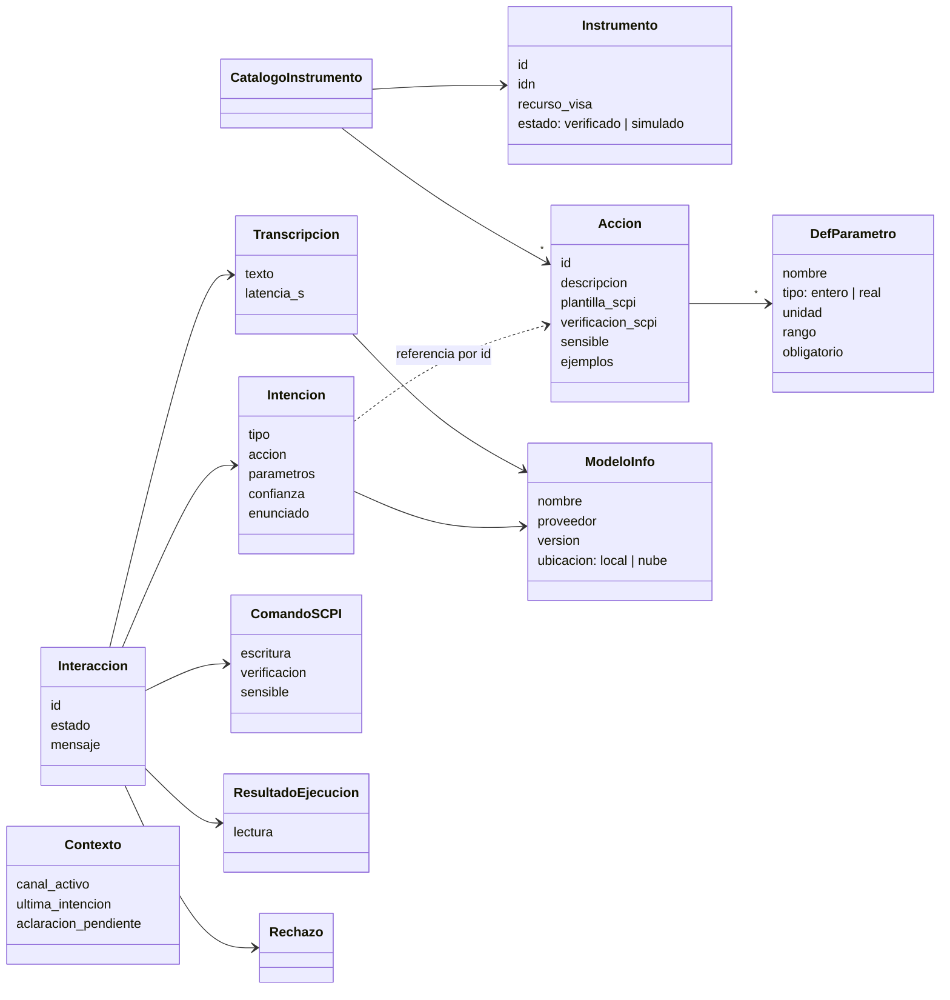

# Modelo de dominio del servidor

> **Estado: propuesta implementada como esqueleto** en [`../servidor/`](../servidor/). Los modelos
> reales de interpretación (D3) y el instrumento real (D1) se enchufan cuando se cierren esas
> decisiones; el resto del servidor no cambia.

## 1. El problema que resuelve

El plan del proyecto prevé cambiar de modelo varias veces: whisper.cpp local o un servicio en la
nube para el ASR (D2); un modelo comercial en la etapa 1 y un modelo abierto ajustado finamente en
la fase 3 para la interpretación (D3). Si cada cambio obliga a tocar la validación o la ejecución,
la frontera de seguridad de [`arquitectura.md`](arquitectura.md) (sección 2) se erosiona con cada
experimento.

Por eso el servidor se organiza en **puertos y adaptadores**: el dominio define qué le pide a cada
modelo, cada modelo concreto es un adaptador que cumple esa interfaz, y cuál se usa se elige por
configuración.

## 2. Entidades



Todo es inmutable: cada etapa produce un objeto nuevo. Definición en
[`../servidor/src/servidor/dominio/modelos.py`](../servidor/src/servidor/dominio/modelos.py).

| Entidad | Qué es |
|---|---|
| **CatalogoInstrumento** | Un instrumento con sus acciones. Se carga de un YAML y es la fuente de verdad: de él salen las herramientas del modelo, las validaciones y el SCPI. |
| **Accion / DefParametro** | Lo que se le puede pedir al instrumento, con tipos, unidades y rangos de ese equipo. |
| **Transcripcion** | El texto que produjo el ASR, con su latencia y **qué modelo** lo produjo. |
| **Intencion** | El contrato de [`esquema_intencion.md`](esquema_intencion.md). También lleva qué modelo la produjo. |
| **ComandoSCPI** | La plantilla de la acción, instanciada con valores ya validados. Solo la construye el módulo `catalogo`. |
| **Rechazo** | Por qué no se ejecuta, en lenguaje claro. |
| **ResultadoEjecucion** | Lo que respondió el instrumento **después** de escribir. |
| **Interaccion** | La traza completa de un pedido. Persistida, es el corpus real de la fase 2. |
| **Contexto** | Estado de la conversación: canal activo, última intención, aclaración pendiente. Sin él, *"subilo un poco"* no tiene sentido. |
| **ModeloInfo** | Quién produjo un resultado. Permite que cada medición de [`evaluacion.md`](evaluacion.md) sepa a qué modelo corresponde. |

## 3. La interfaz común de los modelos

Definida en [`../servidor/src/servidor/dominio/puertos.py`](../servidor/src/servidor/dominio/puertos.py):

```python
class Modelo(Protocol):                 # lo que todo modelo cumple
    def info(self) -> ModeloInfo: ...
    async def salud(self) -> bool: ...

class MotorASR(Modelo, Protocol):
    async def transcribir(self, grabacion: Grabacion) -> Transcripcion: ...

class Interprete(Modelo, Protocol):
    async def interpretar(self, transcripcion: Transcripcion,
                          catalogo: CatalogoInstrumento, contexto: Contexto) -> Intencion: ...
```

Reglas para quien escriba un adaptador:

1. **Recibe y devuelve dominio.** Un intérprete recibe el catálogo como entidades y lo traduce al
   formato de su proveedor con `catalogo.a_json_schema()`; no se declaran las acciones a mano.
2. **Nunca devuelve basura.** Si el modelo responde fuera de esquema, devuelve `fuera_de_alcance`
   o lanza `RespuestaInvalida`. Si el servicio no responde, lanza `ModeloNoDisponible`.
3. **Se identifica.** Todo resultado lleva el `ModeloInfo` del adaptador.
4. **Los parámetros van en unidades del SI y sin unidad.** La unidad la define `DefParametro`; así
   hay un campo menos en el que el modelo se puede equivocar.

## 4. Cómo se intercambian

```
variables de entorno ──► registro.py ──► ProcesarPedido(asr, interprete, catalogo, ejecutor)
ASR_MOTOR=whisper_cpp     MOTORES_ASR = {"whisper_cpp": ..., "fake": ...}
INTERPRETE=fake           INTERPRETES = {"fake": ...}
```

Agregar un modelo es **un archivo adaptador y una línea en el registro**. Que el adaptador sea
realmente intercambiable lo garantizan los **tests de contrato**
([`../servidor/tests/contrato/`](../servidor/tests/contrato/)): la misma batería, parametrizada
sobre todas las implementaciones del puerto. Un adaptador nuevo se agrega a la lista y tiene que
pasarla.

| Puerto | Implementaciones hoy | Previstas |
|---|---|---|
| `MotorASR` | `whisper_cpp`, `fake` | servicio en la nube (D2) |
| `Interprete` | `gemini` (Gemini Flash, salida estructurada), `fake` (guion fijo) | modelo abierto ajustado (fase 3) |
| `ConexionInstrumento` | `InstrumentoFake` | `pyvisa-sim`, PyVISA real (D1) |

El modelo multimodal de la fase 4 entra como un tercer puerto, `audio → Intencion`, que el
orquestador usa en lugar del par ASR + intérprete. Validación y ejecución no se enteran.

## 5. El flujo de un pedido

`ProcesarPedido` ([`../servidor/src/servidor/pipeline.py`](../servidor/src/servidor/pipeline.py)):

| Intención | Validación | Resultado |
|---|---|---|
| `fuera_de_alcance` | — | `rechazada`. No toca el instrumento. |
| `aclaracion` | — | `aclaracion` con la pregunta; queda en el `Contexto`. |
| `accion` / `consulta` inválida | `Rechazo` | `rechazada` con el motivo. |
| `accion` sensible o con confianza bajo el umbral | `ComandoSCPI` | `confirmacion_pendiente`; se ejecuta con `POST /confirmaciones/{id}`. |
| `accion` válida | `ComandoSCPI` | escribe, lee la verificación → `ejecutada`. |
| `consulta` válida | `ComandoSCPI` sin escritura | lee → `consultada`. |
